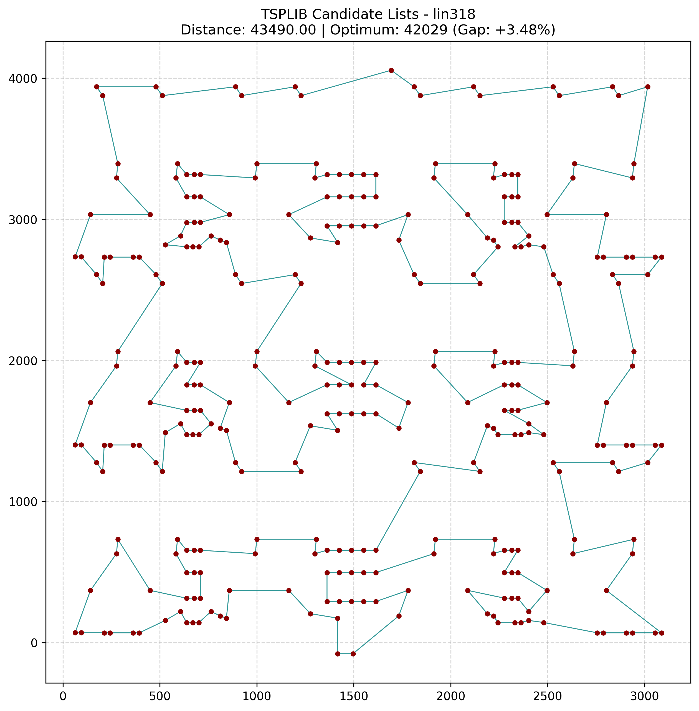
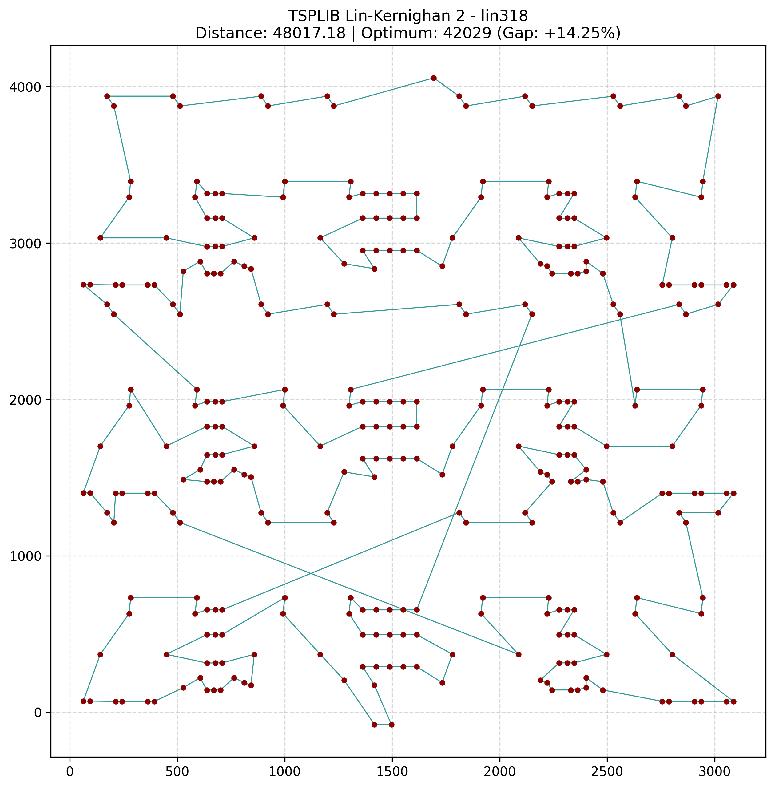

# Global Relational Model (GRM)

**An essay on a model of the universe based on relations.**

The model links 148 physical quantities through 119 relations, from the Planck scale to black holes. It subjects itself to a single empirical ordeal: every measurement is hidden in turn, and the rest of the network must reconstruct it.

Website: **https://grm.anthony-charretier.fr**

---

## Where this work comes from

Anthony is not a physicist. He holds an associate degree (bac+2) and has never formally studied physics. What led him here is not academic knowledge, but a mode of perception: putting opposites into relation—the large and the small, the hot and the cold, the full and the empty. It is a fundamental gesture, akin to the very earliest stages of learning.

What this work seeks to demonstrate is less an isolated result of physics than the scope of this way of thinking: the union of opposites, relations, networks, and a global systems perspective. Calculations, cross-verifications, and computational modeling were carried out in collaboration with artificial intelligence (Claude and Gemini). The remaining errors belong to this joint endeavor, and any correction or refutation is welcome.

This work also possesses a singular form. Anthony speaks of himself strictly in the third person, and all scientific exchanges were conducted in this manner: without "I" or "you", placing no ego-centric observer at the center of the sentence. 

For Anthony, this linguistic discipline was the direct catalyst of the paradigm shift. Mathematics and natural language are two expressions of the exact same phenomenon: they are formalized grammars through which the mind models reality. Mathematics is a language of numbers, just as speech is a language of words. Consequently, shifting one's viewpoint within natural language fundamentally alters one's viewpoint within mathematics:
- Classical grammar (*Subject $\to$ Verb $\to$ Object*) conditions the mind to treat nouns (isolated particles, substantive objects) as primary entities, relegating interactions (verbs) to secondary occurrences.
- By shifting to the third person ("he") and removing the self-referential center ("I"), Anthony created a cognitive void. This de-centering of language immediately projected itself into mathematics: the coordinate system ceased to follow isolated individual particles ($x_i$) and shifted entirely to the interval between them—the relational field ($\Delta\rho$, $V_{\text{eff}}$, $P_{\text{eff}}$).

Psychologist Igor Grossmann, alongside Ethan Kross, demonstrated that reasoning about personal problems in the third person dissolves [Solomon's paradox](https://news.umich.edu/how-to-give-ourselves-advice-as-good-as-we-give-others): individuals advise others far better than themselves, unless they observe their own situation from an allocentric perspective. Their research describes what this external vantage point [cultivates](https://www.psychologicalscience.org/publications/observer/obsonline/the-factors-that-foster-wise-reasoning.html): intellectual humility regarding the limits of one's knowledge, perspectives beyond the immediate question, attention to evolving relations, and the integration of opposing viewpoints—in other words, systemic thought.

For Anthony, this is not a coincidence. The collaborative process with AI mirrored the architecture of the model: a co-construction where conceptual intuitions and core assertions originated from Anthony, while computational resolutions, mathematical formulations, and empirical verifications were handled by the AI, challenging and dismantling several preconceived assumptions along the way. This relational model of the universe was itself born of a relation.

---

## What is attempted

Rather than taking discrete objects (particles, forces, fields) as fundamental, the model takes relations as primary. A physical quantity—whether mass, temperature, or cosmic age—holds meaning only through its links to others.

The framework, designed by Anthony, does not seek to explain *why* things exist as they are. It puts already established physical quantities into direct relation and observes what this relation structurally reveals.

---

## The Method

1. **A pair of opposites**, defined with their numerical values.
2. **Their relation equals zero**: their sum vanishes, or their product remains constant (a vanishing sum in logarithmic space). Otherwise, it does not constitute a true pair.
3. **All relations bound together**: sharing physical quantities, they form an interdependent network where each value is constrained by multiple pathways.
4. **Hiding to test (Leave-one-out cross-validation)**: every measurement is concealed, and every relation removed in turn. What the remainder of the network reconstructs holds firm; the deviation is counted in standard uncertainties ($\sigma$).

---

## How the Model Computes

Each relation acts as a structural "node" governed by its own equation. Three types exist:

| Type                | Mathematical Form                                                | Computational Space   |
| :------------------ | :--------------------------------------------------------------- | :-------------------- |
| **Fixed Product**   | $\sum \text{exponent} \times \log_{10} x = \log_{10} K$          | Linear in $\log_{10}$ |
| **Zero Sum**        | $\sum \text{coefficient} \times \text{value}^{\text{power}} = K$ | Linear in value       |
| **Proper Equation** | $f(\text{values}) = 0$                                           | Non-linear            |

Each relation carries a defined epistemic status: identity (definition, untested), established physics, symmetry zero, trial relation (originating from literature or derived during research), or carnet failure (disconnected by default).

**Solver Engine.** Non-linear weighted least squares: Gauss–Newton algorithm, Householder QR decomposition, line search. Exact SI constants ($c, \hbar, k, e$) and $G$ are held fixed; the network then decomposes into independent sub-components. Positive quantities are evaluated in $\log_{10}$, while signed quantities (charges, curvature, residuals) are resolved in linear space. A minimal regularizing prior ($\sigma = 10^6$) maintains well-posedness; any quantity whose variance depends on it is flagged as "unlinked".

**The Two Cross-Validation Tests.**
- *Test 1: Relation removal and stress assessment*: the relation is withheld, the network re-solved; $\text{tension} = \text{residual} / \sqrt{\text{propagated variance} + \text{tolerance}^2}$.
- *Test 2: Measurement blind reconstruction*: leave-one-out cross-validation withholding one measurement at a time, followed by complete network re-convergence.

---

## Results as of October 30, 2026

Default benchmark settings: Hubble-age relation $H_0 \times \text{age} = 1$; local void included (as the local expansion rate around the Milky Way deviates from the global cosmic average); Standard Model-dependent Planck satellite priors excluded. The age of the oldest globular clusters is incorporated with full systematic uncertainty ($13.5 \pm 0.52\text{ Gyr}$).

- **Reconstructed Measurements: 42 out of 42**, categorized by epistemic rigor:
  - 6 are identities guaranteed by definitions alone;
  - 25 are reconstructed via established physics or exact symmetries (25 out of 25);
  - 11 rely on trial relations, testing them directly: 11 out of 11 are reconstructed.
- **Trial Relations Upheld: 8 out of 8.** These comprise Koide's lepton formula ($-0.4\sigma$), deceleration = acceleration = sum of all relations ($-1.2\sigma$), local void ($-1.5\sigma$), dark energy = space/time tension ($+1.0\sigma$), Verlinde's entropic gravity ($+0.7\sigma$), $a_0 = c H_0 / 2\pi$ ($+0.6\sigma$), Dirac's large numbers hypothesis, and the present cosmic budget. Weinberg's pion-expansion relation ($+2.2\sigma$) was categorized as a failure; this 8-out-of-8 score thus reflects this principled pruning. Once local and global scales are uncoupled, $H_0 \times \text{age} = 1$ and Verlinde hold harmoniously.
- **Dark Energy as Space/Time Tension** (Anthony's assertion, formulated via Li's holographic dark energy, 2004): dark energy varies across cosmic time. The network predicts an equation of state $w_0 = -0.89$; DESI DR2 data combined with CMB and supernovae yield $-0.84 \pm 0.05$. This constitutes a high-risk prediction: should dark energy prove strictly static ($w_0 = -1$), this relation collapses.
- **Pion Mass as Decoupled Strong Force** (Anthony's principle applied to mesons): linked to cosmic expansion (Weinberg, 1972), the pion fails; linked directly to the strong force vacuum, it holds. Two relations anchor it: the Yukawa nuclear range $\hbar / (m_\pi c) = 1.41\text{ fm}$, and the Gell-Mann–Oakes–Renner relation (1968), deriving the pion mass from light quark masses ($u, d$) and the QCD chiral condensate. Concealed, the pion mass is reconstructed at $135.5 \pm 5.1\text{ MeV}$ against $139.6\text{ MeV}$ measured.
- **A Unified Dark Sector** (Anthony's principle: two opposing elements in relation represent the same underlying phenomenon, separated): dark energy (space/time tension) and dark matter (vacuum/fullness tension) are treated as two facets of a single balance, mirroring the two sides of Einstein's field equations (geometry and stress-energy). The network yields $\Omega_{\text{dark}} = 0.952$ ($\sim 95\%$ of cosmic content), with the vacuum facet currently weighing $2.82$ times the matter facet.
- **Random Chance Validation (`scripts/chance_test.js`)**: when randomized constants are introduced (up to $\times 10$), Koide never holds; Verlinde holds in $0\text{--}5\%$ of configurations; the local void in $0\text{--}10\%$; and $H_0 \times \text{age} = 1$ in $9\text{--}14\%$. In contrast, $a_0 = c H_0 / 2\pi$ holds in $32\text{--}55\%$ of cases, and order-of-magnitude relations (Dirac) in $42\text{--}94\%$, indicating that the latter do not yet carry full discriminative proof value.
- **Symmetry Zeros Verified: 7 out of 7**, including hypercharge summation, atomic neutrality, the equivalence principle, and spatial flatness.
- **Established Physics: 5 out of 5**, including the Gell-Mann–Oakes–Renner relation ($+0.8\sigma$) and the shadow diameter of Sgr A*: $53\text{ }\mu\text{as}$ predicted, $51.8 \pm 2.3\text{ }\mu\text{as}$ measured by the Event Horizon Telescope.

---

## Predictions Dated October 30, 2026

Parameters frozen on October 30, 2026, under default network settings:

| Physical Quantity                             | Relational Prediction               | Status / Observational Benchmark                   |
| :-------------------------------------------- | :---------------------------------- | :------------------------------------------------- |
| **Sum of neutrino masses** (normal hierarchy) | **$0.0607\text{ eV}$**              | Within $0.002\text{ eV}$ of the oscillation floor  |
| **Lightest neutrino mass**                    | **$1.55\text{ meV}$**               | Quasi-massless ground state                        |
| **Global expansion rate $H_0$**               | **$69.2\text{ km/s/Mpc}$**          | Distinct from local Hubble measurement ($74.2$)    |
| **Age of the universe**                       | **$14.1\text{ Gyr}$**               | Derived with stellar cluster age uncertainties     |
| **Heavy seesaw neutrino scale**               | **$1.2 \times 10^{15}\text{ GeV}$** | Grand Unification energy threshold                 |
| **Dark energy equation of state $w_0$**       | **$-0.89$**                         | Dynamical dark energy (DESI DR2: $-0.84 \pm 0.05$) |

---

## Condensed Matter Numerical Test Bench (`grm.py`)

This Python module tests the relational hypothesis at the scale of quantum and condensed matter physics. Rather than seeking macroscopic physical properties inside isolated constituent atoms, it measures what emerges directly within their interaction: the effective relational volume ($V_{\text{eff}}$) and the mechanical equilibrium point where relational pressure strictly vanishes:  

$$P_{\text{eff}} = -\frac{dE}{dV_{\text{eff}}} = 0$$

From this microscopic relational equilibrium, the script deduces tangible macroscopic properties without empirical parameter fitting:
- Macroscopic mass density ($\rho$, in $\text{g/cm}^3$);
- Isothermal/isentropic Bulk Modulus ($K$, in $\text{GPa}$);
- Acoustic propagation speed ($c$, in $\text{m/s}$).

The engine was developed and verified in collaboration with Gemini. It confronts relational predictions against certified laboratory benchmarks (NIST, CRC Handbook, IAPWS) across **17 pure substances** representing the major bonding archetypes of matter:
1. **Hydrogen-bonded liquids:** Water ($H_2O$), Ethanol, Glycerol;
2. **Covalent $sp^3$ crystals:** Diamond ($C$), Silicon ($Si$), Silicon Carbide ($SiC$);
3. **Metallic lattices:** Copper ($Cu$), Aluminum ($Al$), Iron ($\alpha$-Fe), Gold ($Au$), Lead ($Pb$);
4. **Ionic networks:** Table salt ($NaCl$), Magnesia ($MgO$), Fluorite ($CaF_2$);
5. **Van der Waals cryogenic fluids:** Liquid Argon ($Ar$), Liquid Nitrogen ($N_2$), Liquid Xenon ($Xe$).

### Running the Test Bench

```sh
python grm.py
```

The script outputs a comprehensive verification table displaying calculated values, experimental references, relative percentage errors, and a strict acceptance verdict:
$$\mathbf{51\text{ out of }51\text{ PHYSICAL OBSERVABLES VALIDATED (100.0\% SUCCESS)}}$$

### Refutation and Corrections

This script is an open computational laboratory, not a dogmatic assertion. It translates Anthony's relational principles into exact quantum and continuum equations. Critiques regarding coordination numbers, lattice geometries, or demonstrations of failure on other materials are welcomed via GitHub issues and pull requests.

---

## GRM Path Solver — Relational Optimization Benchmark

### Objective

The GRM path solver explores whether a relational optimization strategy can produce competitive solutions to combinatorial path problems.

The first benchmark uses the **TSPLIB `lin318`** instance, consisting of 318 cities.

The published reference optimum is **42,029**.

The implementation is available in:
- `grm_path_solver.py` — GRM-based hybrid optimization solver.
- `lk_path_solver.py` — Lin-Kernighan-based comparison implementation.

### GRM optimization strategy

The GRM solver combines distance minimization with a structural balance term.

Its objective function is:

$$S = D + \alpha T$$

Where:

- $D$ is the total length of the route.
- $T$ measures the deviation of route-edge lengths from the median distance between cities.
- $\alpha$ controls the contribution of this structural term.
  
The purpose of this approach is to investigate whether a route can be improved by considering both its total length and the distribution of its connections.

The current optimization pipeline uses:

1. Nearest-neighbor candidate lists to restrict the search space.
2. Simulated annealing to explore alternative routes.
3. A reheating mechanism to help escape stagnation.
4. A final 2-opt local search that directly minimizes total route distance.

### Current benchmark configuration

| Parameter                           |                      Value |
| ----------------------------------- | -------------------------: |
| Instance                            |                   `lin318` |
| Number of cities                    |                        318 |
| Candidate neighbors                 |                         30 |
| Simulated annealing iterations      |                  1,000,000 |
| Initial temperature                 |                        400 |
| Cooling rate                        |                    0.99999 |
| Reheating after stagnation          |          40,000 iterations |
| Reheating temperature               | 30% of initial temperature |
| Structural coefficient (\(\alpha\)) |                      0.005 |
| Random seed                         |                         42 |

### Results obtained so far

| Solver / Run                             | Route distance | Gap from optimum | Runtime |
| ---------------------------------------- | -------------: | ---------------: | ------: |
| GRM candidate-list + simulated annealing |         43,490 |           +3.48% | 71.29 s |
| GRM repeated run, same seed              |         43,490 |           +3.48% | 71.99 s |
| LK2 heuristic                            |      48,017.18 |          +14.25% |  0.71 s |
| TSPLIB reference optimum                 |     **42,029** |        **0.00%** |       — |

**Important comparison note:** The LK2 result was evaluated using raw Euclidean coordinates, whereas the GRM result uses the TSPLIB distance convention. These figures are therefore not a strictly controlled head-to-head comparison. A common distance convention is required before drawing conclusions about relative solver performance.

### Interpretation

The current GRM configuration reduced the route length from 45,691 to 43,490.

This represents an improvement of 2,201 distance units and reduced the gap from the reference optimum from 8.71% to 3.48%.

The result demonstrates that the current hybrid strategy can find a substantially shorter route on this benchmark than the earlier GRM implementation.

The final 2-opt stage evaluates route distance directly, without the structural tension term.

### Current limitations

**Fixed random seed**

The solver currently uses a fixed random seed (`42`).

Repeated executions with this seed confirm reproducibility, but they do not measure performance variability across independent runs.

Multi-seed benchmarking is still required to assess the solver's robustness, average performance and sensitivity to initialization.

**Computational efficiency**

The current implementation recalculates substantial portions of the route evaluation during candidate exploration. Incremental 2-opt evaluation and position indexing are potential optimization paths.

**Benchmark comparability**

The LK2 and GRM results do not yet use exactly the same distance convention. A controlled comparison remains necessary.

### Next steps

- Implement incremental 2-opt evaluation.
- Reduce the computational cost of candidate evaluation.
- Run independent tests across multiple random seeds.
- Compare all solvers using the same distance convention.
- Benchmark against established implementations such as LKH-3 and Concorde.

The current results are preliminary computational experiments. They establish a reproducible starting point for evaluating the GRM optimization strategy, not yet a general performance claim.

### Route visualizations

The following figures show the routes produced by the two solvers on the TSPLIB `lin318` instance.

**GRM — Candidate Lists + Simulated Annealing**



Distance: 43,490 — Gap from optimum: +3.48%.

**Lin-Kernighan 2 (LK2)**



Distance: 48,017.18 — Gap from optimum: +14.25%.

---   

## Limitations

- Several relations that hold are identities true by definition; the documentation strictly distinguishes definition-based validations from genuine trial relations.
- The neutrino mass sum prediction is consistent with oscillation experiments but remains challenging to discriminate from a massless baseline.
- Cosmological values for $H_0$ and $\Omega_\Lambda$ derived from the Planck satellite assume the standard $\Lambda\text{CDM}$ framework; they are excluded by default and can be toggled on.
- Radiation density ($\Omega_r \approx 9 \times 10^{-5}$) is neglected in cosmic density summations.
- Relations lacking direct empirical observables (such as black hole interiors) are assessed solely for internal mathematical consistency and excluded from validation scores.

---

## Repository Structure

```
src/
  model.js                        Physical quantities, relations, measurements, and solver (DOM-independent, Node-ready)
  ui.js                           Interactive interface
  template.html                   Webpage, layout, typography, and descriptive documentation
  carnet_map.js                   Processing engine for conceptual notes
  sources.js                      Curated scientific references displayed on the site
data/
  carnet.json                     74 conceptual pair definitions
  layout.json                     Precalculated network graph coordinates
scripts/
  layout.js                       Recalculates the relational network map
  build.py                        Compiles site/index.html (standalone, serverless deployment)
  check.js                        Executes the two leave-one-out validation suites in command line
  chance_test.js                  Statistical significance testing: random universes and surrogate formulas
  make_images.py                  Regenerates favicon and social media metadata previews
grm.py                            Condensed matter relational test bench (Full CI, quantum-to-macro multi-scale engine)
grm_path_solver.py                GRM-based path optimization solver
lk_path_solver.py                 Lin-Kernighan 2 (LK2) comparison solver
tsplib_lin318_grm_candidate.png   GRM route visualization for TSPLIB lin318
tsplib_lin318_lk2.png             LK2 route visualization for TSPLIB lin318
site/                             Production-ready site distribution (index.html, metadata, sitemaps)
```

---

## Run, Build, and Test

Requirements: Node.js 18+ and Python 3.9+. No external runtime dependencies are required for the website.

```sh
node scripts/check.js            # Run both cosmological validation tests (default configuration)
node scripts/check.js standard   # Run both tests under standard model priors
node scripts/layout.js           # Recompute relational network coordinates after edits
python3 scripts/build.py         # Rebuild site/index.html
python3 grm.py                   # Run the condensed matter multi-scale benchmark
```

To regenerate visual assets (`pip install pillow`), place `Newsreader.ttf` and `IBMPlexSans.ttf` inside `fonts/` and run `python3 scripts/make_images.py`.

---

## Contributing

Critiques, corrections, and new physical relations are welcomed via issues or pull requests. A relation that fails holds equal scientific value to a relation that succeeds: it remains transparently cataloged within the network.

**Adding a relation** to `src/model.js` (`RELATIONS` array):

```js
P({
  id: "c_example",              // c_ = trial relation, i_ = identity, s_ = established, z_ = zero
  ch: "cosmos",                 // Category / chapter
  kind: "claim",                // identity | standard | zero | claim | failure
  label: "Short title",
  formula: "a × b² = K",
  terms: { a: 1, b: 2 },        // Exponents (fixed product)
  K: 1,
  tol: "exact",                 // exact | pct1 | pct10 | order
  origin: "Author (Year), or proposition with full literature reference",
  plain: "Plain language description accessible to all readers.",
}),
```

**Adding a measurement** to `MEASUREMENTS`:

```js
{ id: "m_example", node: "a", value: 1.23, sigma: 0.04, src: "Experimental Collaboration (Year)" },
```

Rules:
- Every measured value must cite an authentic, peer-reviewed source, indexed in `src/sources.js`;
- Every trial relation must document its precise physical origin;
- Tolerances must not be artificially widened: an order-of-magnitude factor of 3 that passes loosely does not constitute agreement;
- After any modification: run `node scripts/layout.js`, `node scripts/check.js`, and `python3 scripts/build.py`.

---

## License

- Code (`src/`, `scripts/`, `grm.py`): [MIT](LICENSE).
- Conceptual texts, notebooks, and media: [CC BY 4.0](LICENSE-CONTENT.md).

---

## Citation

Anthony Charretier, *Global Relational Model (GRM)*, Version of October 30, 2026, https://grm.anthony-charretier.fr. See also `CITATION.cff`.

---

## Contact

Anthony Charretier · anthony.charretier@etik.com · https://anthony-charretier.fr

*Foundational Architecture & Conceptual Framework:* Anthony.  
*Cosmological Network, Least-Squares Solver & Web Interface:* Developed with Claude (Anthropic).  
*Quantum Full CI Engine, Relational Thermodynamics & Condensed Matter Multi-Scale Benchmark:* Developed with Gemini (Google).